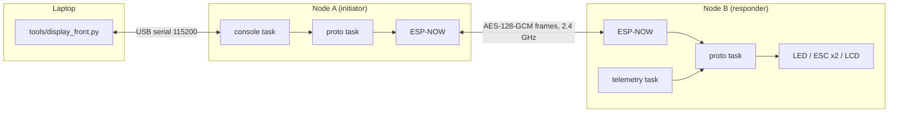
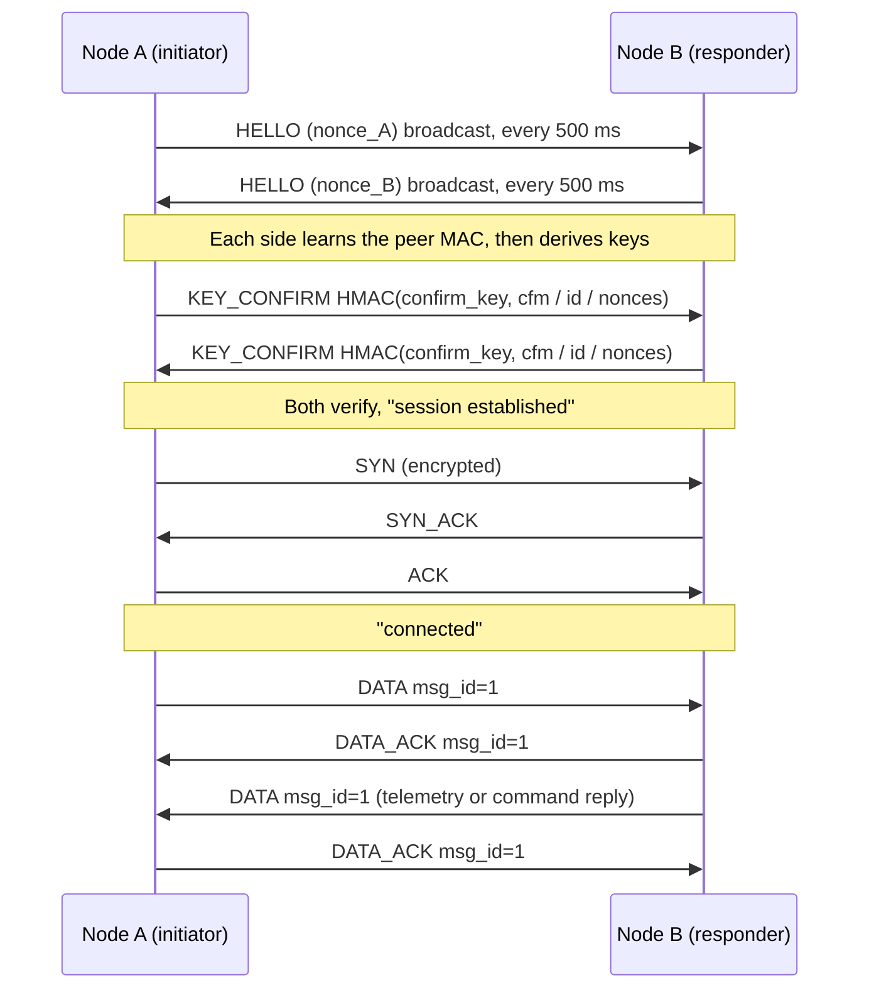
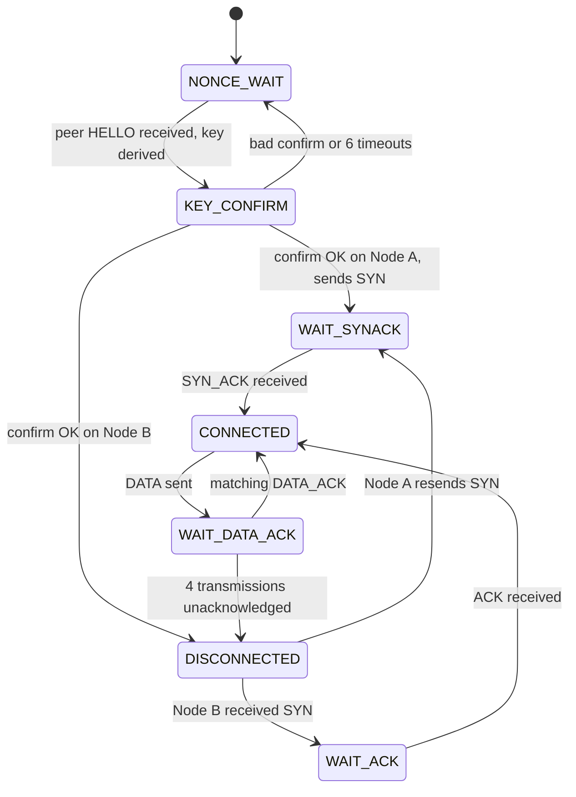

# esp32-secure-link

**Authenticated, encrypted point-to-point control and telemetry between two ESP32 boards over ESP-NOW, with no router, no pairing step and no hard-coded MAC addresses.**

[](https://docs.espressif.com/projects/esp-idf/en/v5.1/esp32/)
[](https://www.espressif.com/en/products/socs/esp32)
[](#security-model)
[](#license)

One board (**Node A**) plugs into your laptop and acts as a secure serial bridge. The other (**Node B**) runs on its own, pushes telemetry back, and executes commands you type on the laptop: toggle an LED, drive two brushless-motor ESCs, or write text to a 16×2 LCD. Every byte that crosses the air is sealed with AES-128-GCM, and the two nodes prove to each other that they share a secret before any application data is accepted.

This project is the ESP32 port of a bare-metal secure-UART framework (SiFive / QEMU, RISC-V). The protocol shape is the same: magic header, sequence numbers, authenticated encryption, SYN / SYN-ACK / ACK, stop-and-wait DATA with retries. The transport and concurrency model are completely different. See [Lineage](#lineage-and-what-changed-from-the-risc-v-version).

---

## Table of contents

- [Features](#features)
- [How it fits together](#how-it-fits-together)
- [Hardware](#hardware)
- [Repository layout](#repository-layout)
- [Quick start](#quick-start)
- [Configuration reference](#configuration-reference)
- [Usage](#usage)
- [How it works](#how-it-works)
- [Security model](#security-model)
- [Troubleshooting](#troubleshooting)
- [Known limitations](#known-limitations)
- [Roadmap](#roadmap)
- [Lineage and what changed from the RISC-V version](#lineage-and-what-changed-from-the-risc-v-version)
- [Contributing](#contributing)
- [License](#license)

---

## Features

- **Zero-config peer discovery.** Nodes broadcast a handshake frame until they hear each other, learn the peer MAC from the received frame, then switch to unicast.
- **Authenticated encryption.** AES-128-GCM via mbedTLS (uses the ESP32 hardware AES accelerator). The full 14-byte packet header is authenticated as associated data, so type, IDs, sequence number and message ID cannot be altered in flight.
- **Mutual key confirmation.** An HMAC-SHA256 exchange proves both sides hold the same pre-shared key (PSK) before the session is trusted.
- **Reliable delivery on a lossy radio.** Stop-and-wait with ACKs, bounded retries, and a fresh nonce on every retransmission.
- **Replay protection that tolerates reordering.** A 64-packet sliding window instead of a single "last seen" counter, plus message-ID duplicate suppression.
- **Automatic recovery.** If the peer reboots, the link notices and re-handshakes. The AES-GCM nonce budget triggers a rekey long before it could wrap.
- **Real hardware actions.** Remote LED control, two-channel ESC/BLDC PWM with a hard speed cap and demo patterns, and an HD44780 16×2 LCD driver.
- **Dual-core design.** Wi-Fi and the receive callback live on core 0. All crypto, state machine, console and telemetry work lives on core 1, so no mutex is needed around the GCM context.
- **Laptop front-end.** A small `pyserial` tool plus a `tmux` launcher that splits the screen into a live log and an input prompt.

## How it fits together



You type `MOTOR:SPEED 30` in the front-end. Node A seals it and sends it to Node B. Node B decrypts, checks it is not a replay, executes it, and sends `ACK: Motors set to speed 30.0%` back through the same encrypted channel. Node B also sends a `TLM ...` line every five seconds on its own.

## Hardware

### Required

| Item | Notes |
| --- | --- |
| 2 × ESP32 board | Developed on **ESP32-WROOM-32U** DevKits. Any classic ESP32 works. |
| 2 × USB cable | Node A to the laptop. Node B can sit on a USB power bank. |

> **ESP32-WROVER users:** the LCD uses GPIO16 and GPIO17, which WROVER modules reserve for PSRAM. Change the pins in `main/lcd.h`.

### Optional peripherals (Node B only)

| Peripheral | Signal | ESP32 GPIO | Defined in |
| --- | --- | --- | --- |
| Status LED | LED | **2** (onboard LED on most DevKits) | `ACTION_PIN` in `app_main.c`, `protocol.c` |
| ESC / motor 1 | PWM, 50 Hz, 1–2 ms | **18** | `MOTOR_PIN_1` in `bldc.h` |
| ESC / motor 2 | PWM, 50 Hz, 1–2 ms | **19** | `MOTOR_PIN_2` in `bldc.h` |
| HD44780 16×2 LCD, RS | 4-bit mode | **22** | `LCD_PIN_RS` in `lcd.h` |
| LCD EN | | **23** | `LCD_PIN_EN` |
| LCD D4 | | **21** | `LCD_PIN_D4` |
| LCD D5 | | **17** | `LCD_PIN_D5` |
| LCD D6 | | **16** | `LCD_PIN_D6` |
| LCD D7 | | **4** | `LCD_PIN_D7` |

LCD wiring notes: tie RW to GND, add a contrast pot on V0, and share GND with the ESP32. Most HD44780 modules powered at 5 V accept 3.3 V logic levels, but check yours.

> **Motor safety.** Remove propellers and secure the motors before testing. The firmware caps manual speed at **50 %** (`MAX_SAFE_SPEED_PCT` in `bldc.c`), but anyone holding the PSK can command the motors. Power the ESCs and let them arm at minimum throttle before sending speed commands. The ESC and LCD code is only initialised on Node B.

## Repository layout

```
Secure-Embedded-Communication-Framework-Implementation-on-esp32/
├── CMakeLists.txt              top-level ESP-IDF project (project name: esp32_secure_link)
├── LICENSE                     MIT license text
├── .gitignore                  keeps build output, logs and PSK-bearing sdkconfig files out of git
├── sdkconfig.defaults          options that must not be left at defaults (HKDF, GCM, tick rate, flash size)
├── main/
│   ├── CMakeLists.txt          component registration
│   ├── Kconfig.projbuild       "Secure Link Configuration" menu (role, channel, PSK, telemetry)
│   ├── link_config.h           node IDs, timers, queue sizes, task priorities, core pinning
│   ├── app_main.c              boot sequence and role-specific hardware init
│   ├── packet.h / packet.c     wire format: build, serialize, parse, bounds checks
│   ├── crypto.h / crypto.c     HKDF-SHA256 key derivation, HMAC confirm, AES-128-GCM seal/open
│   ├── espnow_link.h / .c      NVS, Wi-Fi STA, ESP-NOW init, peer learning, RX callback
│   ├── protocol.h / protocol.c event loop, handshake, state machine, replay window, command parser
│   ├── console_io.h / .c       UART0 <-> link bridge (Node A)
│   ├── telemetry.c             periodic autonomous sender (Node B)
│   ├── bldc.h / bldc.c         two-channel ESC PWM driver and demo patterns
│   └── lcd.h / lcd.c           HD44780 4-bit driver
└── tools/
    ├── display_front.py        laptop front-end (pyserial)
    └── run_disp.sh             tmux launcher: live log on top, prompt below
```

## Quick start

### 1. Prerequisites

- **ESP-IDF v5.1 or newer.** The `esp_now_recv_info_t` receive-callback signature is v5-only. Developed and tested with **v5.1.7**. [Install guide](https://docs.espressif.com/projects/esp-idf/en/v5.1/esp32/get-started/index.html).
- Python 3.8+ with `pyserial` for the laptop tool.
- `tmux` (optional, Linux / macOS / WSL) for the split-screen launcher.
- On Linux, add yourself to the serial group so you can flash without `sudo`: `sudo usermod -aG dialout $USER`, then log out and in.

### 2. Get the code

```bash
git clone https://github.com/AKSHAY-ISSAR/Secure-Embedded-Communication-Framework-Implementation-on-esp32.git
cd Secure-Embedded-Communication-Framework-Implementation-on-esp32
. $HOME/esp/esp-idf/export.sh          # adjust to your ESP-IDF install path
idf.py set-target esp32
```

### 3. Build and flash each node

Use **separate build directories and separate sdkconfig files** so you never reconfigure back and forth between roles.

**Node A: the board plugged into your laptop**

```bash
idf.py -B build_a -D SDKCONFIG=sdkconfig.a -D SDKCONFIG_DEFAULTS=sdkconfig.defaults menuconfig
#   Secure Link Configuration -> Node role  = Node A
#   Secure Link Configuration -> PSK        = <your secret>
idf.py -B build_a -D SDKCONFIG=sdkconfig.a -D SDKCONFIG_DEFAULTS=sdkconfig.defaults build
idf.py -B build_a -D SDKCONFIG=sdkconfig.a -p /dev/ttyUSB0 flash
```

**Node B: the autonomous node**

```bash
idf.py -B build_b -D SDKCONFIG=sdkconfig.b -D SDKCONFIG_DEFAULTS=sdkconfig.defaults menuconfig
#   Secure Link Configuration -> Node role  = Node B
#   Secure Link Configuration -> PSK        = <the SAME secret as Node A>
idf.py -B build_b -D SDKCONFIG=sdkconfig.b -D SDKCONFIG_DEFAULTS=sdkconfig.defaults build
idf.py -B build_b -D SDKCONFIG=sdkconfig.b -p /dev/ttyUSB1 flash
```

> **Both nodes must use the same Wi-Fi channel and the same PSK.** Everything else is per-role. On Windows, replace `/dev/ttyUSBn` with `COMn`.

> **Never commit your configured `sdkconfig.*` files.** They contain your PSK in plain text. The included `.gitignore` excludes them.

### 4. Run

Node B can be powered from a USB power bank. Node A stays on the laptop:

```bash
pip install pyserial

# Option 1: split-screen with tmux (run from the repo root)
chmod +x tools/run_disp.sh
./tools/run_disp.sh /dev/ttyUSB0

# Option 2: plain, two terminals
python3 tools/display_front.py /dev/ttyUSB0      # input prompt
tail -f telemetry.log                            # live output (second terminal)
```

> `display_front.py` writes everything it receives to `telemetry.log` in the current directory rather than to the screen. That is why a second pane runs `tail -f` on it. On Windows PowerShell use `Get-Content telemetry.log -Wait`.

> Do not run the Python front-end and `idf.py monitor` on the same serial port at the same time. Use `idf.py monitor` on **Node B's** port if you want to watch its side.

### 5. What a healthy start looks like

In `telemetry.log` (ANSI colour codes removed):

```
W (1579) link: peer locked: aa:bb:cc:dd:ee:ff
W (2078) proto: session established
W (2082) proto: connected
TLM n=1 up=5s heap=210424
TLM n=2 up=10s heap=210424
```

Type `LED_ON` and press Enter. You should see `ACK: Action 'LED_ON' executed. Feature is ON.` and the LED on Node B lights.

## Configuration reference

### Menuconfig: `Secure Link Configuration`

| Option | Default | Meaning |
| --- | --- | --- |
| `LINK_NODE_ROLE` | Node A | **A** = initiator (sends SYN), laptop-attached. **B** = responder, autonomous. Role also sets the node ID (`0xA1` / `0xA2`). |
| `LINK_WIFI_CHANNEL` | 6 | ESP-NOW channel, 1 to 13. Must match on both nodes. |
| `LINK_PSK` | `change-me-before-you-deploy-this` | Pre-shared secret mixed into key derivation. Must match on both nodes. **Change it.** |
| `LINK_ENABLE_CONSOLE` | y | UART0 bridge between laptop and link (needed on Node A). |
| `LINK_ENABLE_TELEMETRY` | y on B, n on A | Autonomous periodic sender. |
| `LINK_TELEMETRY_PERIOD_MS` | 5000 | Telemetry interval, 200 to 600000 ms. |
| `LINK_ENABLE_LONG_RANGE` | n | ESP-NOW long-range PHY, roughly 2× range. Must be on for **both** nodes. |

### Compile-time constants (`main/link_config.h`)

| Constant | Value | Meaning |
| --- | --- | --- |
| `DH_RETRY_MS` | 500 | Re-broadcast interval for the handshake `HELLO` (name is a legacy of the DH version) |
| `CONFIRM_TIMEOUT_MS` | 1000 | Wait for the peer's key confirmation (up to 6 retries, then restart) |
| `HANDSHAKE_TIMEOUT_MS` | 1000 | Wait for SYN-ACK / ACK |
| `LISTEN_TIMEOUT_MS` | 2000 | Responder idle wait before re-listening |
| `IDLE_POLL_MS` | 200 | Idle wake-up while connected |
| `ACK_TIMEOUT_MS` | 400 | Wait for a DATA ACK before retransmitting |
| `MAX_ACK_RETRIES` | 4 | Total transmissions per message before it is abandoned |
| `OUTBOX_DEPTH` | 6 | Messages queued while one is in flight |
| `EVENT_QUEUE_DEPTH` | 10 | Frames and text events waiting for the protocol task |
| `CORE_APP` | 1 | Core for all application tasks |
| `PROTO_TASK_PRIO` / `CONSOLE_TASK_PRIO` / `TELEMETRY_TASK_PRIO` | 6 / 4 / 3 | FreeRTOS priorities |

### Required `sdkconfig` options (set in `sdkconfig.defaults`)

| Option | Why |
| --- | --- |
| `CONFIG_MBEDTLS_HKDF_C=y` | **Off by default in ESP-IDF.** Without it `crypto.c` fails to link. |
| `CONFIG_MBEDTLS_GCM_C=y` | AES-GCM. |
| `CONFIG_FREERTOS_HZ=1000` | 1 ms tick so the millisecond timeouts behave as written. |
| `CONFIG_ESPTOOLPY_FLASHSIZE_4MB=y` | Matches typical WROOM-32U modules. Adjust to your board. |

## Usage

### Typing messages

Anything you type in the front-end is sent as one encrypted message (maximum **192 bytes** per line; longer lines are split). Node A prints every message it receives from Node B on its UART, newline-terminated.

### Command reference (executed on Node B)

Commands are **exact, case-sensitive** matches. Trailing carriage returns and newlines are stripped, but a **trailing space is not**: `MOTOR:STOP ` is rejected as unknown. Anything not recognised returns `ERR: Unknown command '...'`.

| Command | Effect | Reply |
| --- | --- | --- |
| `LED_ON` | GPIO2 high | `ACK: Action 'LED_ON' executed. Feature is ON.` |
| `LED_OFF` | GPIO2 low | `ACK: Action 'LED_OFF' executed. Feature is OFF.` |
| `MOTOR:SPIN` or `MOTOR:ON` | Both motors at 20 % | `ACK: Motors running @ 20%` |
| `MOTOR:STOP` or `MOTOR:OFF` | Both motors to 0 %, cancels any pattern | `ACK: Motors stopped` |
| `MOTOR:SPEED <pct>` | Both motors at `<pct>` %. Values above **50** are clamped to 50. Negative values fall back to 15. | `ACK: Motors set to speed <pct>%` (echoes the value you **requested**, even when the motors were clamped to 50 %) |
| `MOTOR:RAMP` | Smooth 10 % ↔ 35 % throttle sweep | `ACK: Pattern started: RAMP` |
| `MOTOR:ALT` | Alternates motor 1 (25 %, 1.8 s) and motor 2 (25 %, 1.2 s) | `ACK: Pattern started: ALTERNATING` |
| `MOTOR:PULSE` | Repeated rev-up / rev-down pulses between 10 % and 30 % | `ACK: Pattern started: PULSE` |
| `LCD <text>` or `LCD:<text>` | Clear the display and show `<text>` (16 columns, wraps to line 2, 32 characters max) | `ACK: Display updated` |

A pattern runs until you send `MOTOR:STOP`, `MOTOR:SPIN` or `MOTOR:SPEED`.

### Telemetry

Node B sends this every `LINK_TELEMETRY_PERIOD_MS` once the session is up:

```
TLM n=<counter> up=<uptime seconds>s heap=<free heap bytes>
```

### Adding your own command

Commands are dispatched in `deliver()` in `main/protocol.c`, in the `#else` (Node B) branch. Add another `else if (strcmp(cmd, "MY_CMD") == 0) { ... snprintf(reply, ...); }` block. The `reply` string is automatically sent back to Node A. Keep replies under 64 bytes (the `reply` buffer size).

## How it works

### Wire format

Every frame is one ESP-NOW packet (maximum 250 bytes; this protocol uses at most 222).

```
off   size  field
 0     1    magic        0xAB
 1     1    version      0x02
 2     1    type         see below
 3     1    sender_id    0xA1 (A) or 0xA2 (B)
 4     1    receiver_id
 5     1    flags        bit0 = plaintext (handshake frames only)
 6     4    seq          big endian, also the GCM nonce counter
10     2    msg_id       application message id
12     2    length       payload length
14     n    payload      ciphertext (or plaintext for handshake frames)
14+n  16    GCM tag      all zero on plaintext handshake frames
```

| Type | Value | Purpose |
| --- | --- | --- |
| `PKT_SYN` / `PKT_SYN_ACK` / `PKT_ACK` | 1 / 2 / 3 | Logical connection setup (encrypted) |
| `PKT_DATA` / `PKT_DATA_ACK` | 4 / 5 | Application message and its acknowledgement (encrypted) |
| `PKT_HELLO` | 6 | Carries a 16-byte random session nonce (plaintext) |
| `PKT_KEY_CONFIRM` | 7 | Carries a 32-byte HMAC proving PSK knowledge (plaintext) |

The 14-byte header is the AEAD associated data, so every header field is authenticated even though it travels in the clear. The 12-byte GCM nonce is `00×7 || sender_id || seq`, which is unique per key because the two nodes have different IDs and `seq` increases on every transmission.

### Session establishment



**Key derivation** (`crypto.c`):

```
salt = nonce_low || nonce_high          (the two nonces sorted lexicographically, so both sides agree)
IKM  = PSK
info = "esplink-psk-v1"
OKM  = HKDF-SHA256(salt, IKM, info, 48 bytes)
         ├─ bytes  0..15  -> AES-128-GCM session key
         └─ bytes 16..47  -> confirmation key
confirm(node_id) = HMAC-SHA256(confirm_key, "cfm" || node_id || nonce_low || nonce_high)
```

A peer that echoes your own nonce back is rejected. The confirmation is compared in constant time.

### Link state machine



### Reliable delivery

- **One message in flight** (stop-and-wait). Others wait in a 6-slot outbox, so the console and telemetry tasks never block on the radio.
- On an ACK timeout (400 ms) the same message is re-sent with the **same `msg_id` but a new `seq`**. The new `seq` gives a fresh GCM nonce and passes the receiver's replay window. The unchanged `msg_id` lets the receiver recognise a duplicate and ACK it again without delivering it twice.
- After `MAX_ACK_RETRIES` (4) total transmissions the message is abandoned and the link falls back to re-sending SYN. The session key is kept.

### Replay protection

The receiver keeps a 64-bit sliding window over `seq`. A frame is accepted only if its tag verifies **and** its `seq` is new (above the window top, or inside the window and not yet seen). Frames with `seq` 0 or older than 64 packets are dropped. This tolerates the reordering that ESP-NOW link-layer retries can produce, which a single "last seen" counter would turn into permanent drops.

### Peer restart and rekey

- If a `HELLO` arrives while connected and **no valid frame has been received for 3 s**, the peer is assumed to have rebooted and a new handshake starts. Ignoring `HELLO` while the link is healthy stops an attacker from forcing rekeys by spraying frames.
- When the transmit counter passes `0xF0000000`, a new handshake starts, well before the 32-bit counter could wrap and repeat a nonce.

### Threading model

| Where | What runs | Why |
| --- | --- | --- |
| **Core 0** | Wi-Fi task and the ESP-NOW `recv_cb` | `recv_cb` does one thing: copy the frame into the event queue with a non-blocking send. No crypto, no logging. Blocking here stalls the radio. |
| **Core 1** | `proto` task (prio 6, 8 KB stack): all AES-GCM, HKDF, state transitions, command execution | A single task owns all crypto, so **no mutex is needed** around the GCM context. |
| **Core 1** | `console` task (prio 4): UART0 line assembly | Posts text into the protocol queue. |
| **Core 1** | `telemetry` task (prio 3): `vTaskDelayUntil` periodic sender | Stable period regardless of sampling time. |
| **Any core** | `bldc_anim` task (prio 3) | Runs motor demo patterns. |

If you later move crypto into a second worker task, you must add a mutex.

### Source map

| File | Responsibility |
| --- | --- |
| `app_main.c` | Boot order: hardware init (Node B only), `espnow_link_init`, `console_start`, `protocol_start`, `telemetry_start` |
| `espnow_link.c` | NVS, Wi-Fi STA on a fixed channel with power-save off, ESP-NOW init, broadcast peer, peer learning |
| `protocol.c` | The event loop, handshake, state machine, outbox, replay window, Node B command dispatcher |
| `crypto.c` | Nonce generation, HKDF, HMAC confirm, GCM seal / open (bounds-checked) |
| `packet.c` | Header write, serialize, parse with strict length validation |
| `console_io.c` | Line-buffered UART0 reader (Node A), output writer |
| `telemetry.c` | Periodic `TLM` text generator |
| `bldc.c` | LEDC PWM at 50 Hz, 14-bit, 1000 to 2000 µs pulses, speed cap, demo patterns |
| `lcd.c` | HD44780 4-bit initialisation, clear, cursor, string with auto-wrap |

## Security model

### What is protected

| Threat | Mitigation |
| --- | --- |
| Eavesdropping on application data | AES-128-GCM on all `SYN`/`ACK`/`DATA` frames |
| Tampering with payload or header | GCM tag over payload, header authenticated as AAD |
| Replay of captured frames | 64-packet sliding window plus `msg_id` duplicate suppression |
| Impersonation without the PSK | HMAC key-confirmation before any secure frame is trusted |
| Cross-session replay | Fresh random nonce from each side in every handshake, so every session derives a different key |
| Nonce reuse under one key | Strictly increasing `seq` per sender, rekey before wrap |
| Forced rekey by a third party | `HELLO` is honoured only after 3 s of silence |

### What is **not** protected. Read this before relying on it

- **No forward secrecy.** The session key is derived from the PSK plus public nonces. If the PSK leaks, an attacker who recorded earlier traffic can decrypt it. Replacing the derivation with an ephemeral ECDH (for example X25519) mixed with the PSK is on the [roadmap](#roadmap).
- **The PSK is the whole secret.** It is compiled into the firmware in plain text. Anyone who can read the flash can recover it, and anyone who has it can control the motors. Enable ESP32 flash encryption and secure boot for anything physically reachable.
- **Offline guessing of weak PSKs.** An attacker who captures one `HELLO` + `KEY_CONFIRM` exchange can test PSK guesses offline. Use a long random PSK (16+ random characters), not a word.
- **Metadata is visible.** Packet type, node IDs, sequence numbers, message IDs and payload lengths are sent in the clear (authenticated, not hidden).
- **No availability guarantees.** Jamming or flooding the channel will disrupt the link. The firmware cannot prevent that.
- **No per-command authorisation.** Any message from an authenticated peer is trusted. There is no roles or permissions model.
- **ESP-NOW's own link-layer encryption is disabled** (`peer.encrypt = false`); the AES-GCM layer above it does the work instead.

This is a hobby and learning project. It has not been audited. Do not use it to protect safety-critical or high-value systems.

## Troubleshooting

| Symptom | Likely cause and fix |
| --- | --- |
| Nodes never connect, no `peer locked` line | Different Wi-Fi channels. Set the same `LINK_WIFI_CHANNEL` on both. Also check that `LINK_ENABLE_LONG_RANGE` matches on both. |
| `confirm mismatch - wrong PSK or MITM` | The PSKs differ. Rebuild both with an identical `LINK_PSK`. |
| Linker error about `mbedtls_hkdf` | `CONFIG_MBEDTLS_HKDF_C` is off. Make sure `sdkconfig.defaults` is passed (`-D SDKCONFIG_DEFAULTS=sdkconfig.defaults`) or enable it in menuconfig. |
| Frames randomly vanish | Power save is on. The code calls `esp_wifi_set_ps(WIFI_PS_NONE)`; do not remove it. If you add an AP connection, the station channel follows the AP and ESP-NOW moves with it. |
| `message N abandoned` in the log | Four transmissions went unacknowledged (out of range, interference, peer busy). The link recovers on its own and re-sends SYN. |
| `handshake restart (peer restarted)` | Normal after rebooting the other node. |
| `ERR: Unknown command '...'` | Commands are exact and case-sensitive. Check for typos such as `MOTOR_ON` (should be `MOTOR:ON`) and for trailing spaces. |
| `cannot open /dev/ttyUSB0` | Wrong port, missing permissions (`dialout` group), or another program (`idf.py monitor`) holds the port. |
| Typed text is silently lost | The 6-slot outbox is full (messages sent faster than one per round trip). Slow down; see roadmap for pipelining. |
| Motor does not respond | ESC not armed. Power it with the signal at minimum throttle and wait for its arming tones, then send `MOTOR:SPEED 10`. |
| LCD blank or garbled | Check contrast (V0), RW tied to GND, and that the pins in `lcd.h` match your wiring. |
| On WSL: board not visible | USB devices are not shared with WSL by default. Use [usbipd-win](https://github.com/dorssel/usbipd-win) to attach the serial port. |

## Known limitations

- **Stop-and-wait throughput.** One message per round trip. Fine for commands and telemetry, slow for bulk data.
- **Payload cap of 192 bytes** per message; no fragmentation.
- **Outbox overflow is silent.** If more than six messages queue up, the newest are dropped.
- **`display_front.py` log tagging.** It labels a line `[log ]` only if it begins with `W `, `E `, `I ` or `D `. ESP-IDF's coloured log lines begin with an ANSI escape code instead, so most log lines are labelled `[peer]`. Cosmetic only.
- **Console and logs share UART0** on Node A, so firmware log lines are interleaved with peer messages.
- **Single peer only.** The design is strictly point-to-point.
- Only the classic ESP32 target is tested.

## Roadmap

- Ephemeral X25519 (ECDH) mixed with the PSK for forward secrecy
- Sliding-window pipelining instead of stop-and-wait
- Fragmentation for messages larger than 192 bytes
- Periodic timed rekey, not just on nonce exhaustion
- PSK stored in NVS with flash encryption instead of in the binary
- A command allow-list and optional confirm-before-actuate for motor commands
- `esp_now_set_peer_rate_config` to trade throughput for range

## Lineage and what changed from the RISC-V version

This is a port of a bare-metal SiFive/QEMU framework that spoke a custom packet protocol over UART1. The wire protocol is recognisably the same; the platform underneath is not.

| RISC-V / QEMU version | This ESP32 version |
| --- | --- |
| `uart.c` on UART1 | `espnow_link.c` (`esp_now_send` + receive callback) |
| `packet_receive_with_timeout`, `packet_resync`, magic-byte scan | Removed: ESP-NOW delivers whole, CRC-checked frames or nothing |
| `while(1)` poll loop | `proto_task` blocking on a FreeRTOS queue, pinned to core 1 |
| `RingBuffer` + `reciving_from_python` | UART driver ring buffer + `protocol_post_text` into the event queue |
| `time.c` / `get_mtime` | `esp_timer_get_time` + `xQueueReceive` timeout |
| Software `aes.c`, `gcm.c` | `mbedtls_gcm_*` (ESP32 hardware AES) |
| `dh.c` (32-bit toy Diffie-Hellman) | HKDF-SHA256 from a PSK and per-session random nonces, with HMAC key confirmation |
| `integrity.c` checksum | Dropped: the GCM tag authenticates header and payload |
| `linker.ld`, `_start`, custom boot | Dropped: the ESP-IDF bootloader handles this |
| `rx_last_seq` single counter | 64-bit sliding replay window |
| 16-byte payload | 192-byte payload (ESP-NOW limit is 250) |

### Bugs in the original that this port fixes

1. **Retransmission deadlock.** The original re-sent the identical encrypted frame with the identical `seq`; the receiver's replay check discarded it, so no ACK ever came and every ACK timeout failed. Here `seq` (the AEAD nonce) is fresh on every transmission and `msg_id` identifies the application message.
2. **Undetected `buffer_write` overflow.** It returned `uint8_t`, so `-1` became `255` and the caller's `== -1` check was always false.
3. **`uart_has_data` popped a byte**, hidden by a file-scope cache that was not reentrant.
4. **A single monotonic `rx_last_seq`** permanently dropped legitimately reordered packets. Replaced by the sliding window.
5. **`integrity.c` referenced a `checksum` field that did not exist** in `Packet`, so it could never have compiled. It is redundant next to GCM and was not carried over.
6. **A fixed 16-byte stack copy** in `secure_send` was one edit away from a stack smash. Bounds are now enforced in `crypto_seal`, `packet_serialize` and `packet_parse`.

## Contributing

Issues and pull requests are welcome. Please:

1. Open an issue first for anything larger than a bug fix.
2. Build both roles (`CONFIG_LINK_ROLE_A` and `CONFIG_LINK_ROLE_B`) before submitting.
3. Never include a real PSK, `sdkconfig` file, build output or log in a commit.

## License

Released under the MIT License. See the `LICENSE` file.
